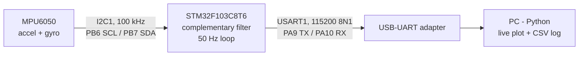

# STM32 IMU Data Logger

Real-time 6-axis motion logger: an **STM32F103C8T6** reads an **MPU6050** over I2C,
estimates roll/pitch with a complementary filter, and streams the data over UART
to a Python app that plots it live and logs it to CSV.

<!-- TODO: add a GIF of the live plot while tilting the board -->
<!--  -->

## System overview



## Features

**Firmware (STM32, C, HAL)**
- MPU6050 driver over I2C: WHO_AM_I check, ±2 g / ±250 °/s, digital low-pass filter, 14-byte burst read
- Gyroscope zero-rate offset calibration at start-up
- Complementary filter for roll and pitch (α = 0.98), with `dt` measured from SysTick
- Fixed 50 Hz loop; each sample is time-stamped with the MCU tick
- Error reporting over UART (`ERR,...`) if the sensor is missing or an I2C read fails

**PC application (Python)**
- Non-blocking serial reader that processes every line received between plot refreshes
- Live plot of acceleration, angular rate and filtered angles
- Each session logged to a new timestamped CSV file
- Simulator to demo the plot without hardware, and unit tests for the parser

## Hardware

| Item        | Details |
|-------------|---------|
| MCU         | STM32F103C8T6, HSI 8 MHz |
| IMU         | MPU6050 (I2C address 0x68) |
| PC link     | USB-UART adapter, 115200 baud |

| MPU6050 | STM32 | USB-UART |
|---------|-------|----------|
| SCL     | PB6   |          |
| SDA     | PB7   |          |
|         | PA9 (TX)  | RX   |
|         | PA10 (RX) | TX   |
| VCC / GND | 3.3 V / GND | GND |

<!-- TODO: check this table against your real wiring -->

## UART data format

One line every 20 ms, 10 comma-separated integers:

```
tick_ms,ax,ay,az,roll,pitch,yaw,gx,gy,gz
15320,12,-8,1003,-45,120,310,25,-14,3
```

| Field            | Scale    | Unit  |
|------------------|----------|-------|
| tick_ms          | 1        | ms    |
| ax, ay, az       | × 1000   | g     |
| roll, pitch, yaw | × 100    | deg   |
| gx, gy, gz       | × 100    | deg/s |

Integers are used so the firmware does not need floating-point `printf`.

## Build & flash the firmware

1. Open STM32CubeIDE → *File → Import → Existing Projects into Workspace* → select `firmware/`
2. Build and flash with an ST-Link
3. **Keep the board still for ~1 s after reset** (gyroscope calibration)

## Run the PC application

```bash
pip install -r requirements.txt
python main.py --port COM17          # Windows
python main.py --port /dev/ttyUSB0   # Linux
```

Close the plot window to stop; the CSV file is saved in `logs/`.

```bash
python tools/simulate_plot.py                  # demo without hardware
python tools/read_raw_serial.py --port COM17   # print raw UART bytes
python -m pytest tests                         # unit tests
```

## Limitations

- **Yaw drifts**: without a magnetometer, yaw is only the integrated gyroscope Z rate.
- Roll/pitch from the accelerometer are only valid when the board is not accelerating strongly.

## Project structure

```
├── firmware/            # STM32CubeIDE project (logic in Core/Src/main.c)
├── main.py              # PC entry point: serial -> parse -> plot + log
├── config.py            # port, baud rate, plot & logger settings
├── serial_reader.py     # non-blocking UART line reader
├── imu_parser.py        # parse the firmware's UART lines
├── plotter.py           # real-time matplotlib plot
├── logger.py            # CSV logger
├── tools/               # simulator, raw serial monitor
├── tests/               # unit tests
└── docs/                # images for this README
```

## Author

TODO: your name - link
